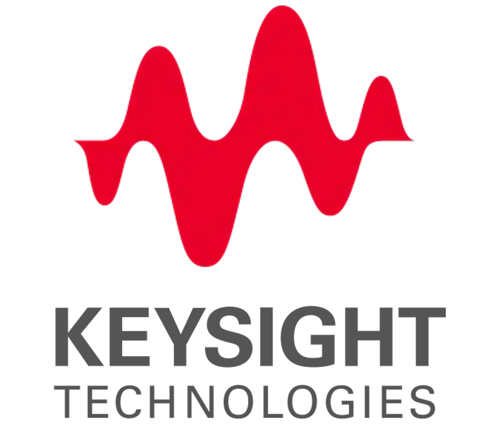

## Education

  

    

      

        
      

      

        <h5 class="font-weight-bold">Ph.D. in Electrical and Computer Engineering</h5>
        <h6 class="font-italic">University of Southern California (USC), Los Angeles, CA</h6>
        <h6 class="font-italic text-muted">August 2025 - Present</h6>
        <ul>
          <li>Advisor: Professor Sungkyu Lim</li>
          <li>Research Focus: EDA for 2.5D/3D IC Design, ML for EDA</li>
        </ul>
      

    

  

  

    

      

        
      

      

        <h5 class="font-weight-bold">Bachelor of Engineering in Electrical and Electronic Engineering</h5>
        <h6 class="font-italic">Yonsei University, Seoul, South Korea</h6>
        <h6 class="font-italic text-muted">March 2019 - August 2025</h6>
      

    

  

---

## Work Experience

  

    

      

        
      

      

        <h5 class="font-weight-bold">PhD Intern, Agentic AI (Modeling Agent)</h5>
        <h6 class="font-italic">Keysight Technologies</h6>
        <h6 class="font-italic text-muted">Incoming · Starting Spring 2027</h6>
        <ul>
          <li>Will develop an LLM agent that examines an engineering dataset and proposes how to prepare the data, train a model, and optimize a design.</li>
          <li>Will connect the agent to simulation and optimization tools so engineers can inspect its choices, revise a configuration, and reproduce a run.</li>
          <li>Will benchmark the agent against expert-configured workflows, measuring task completion and model quality under a compute budget.</li>
        </ul>
        <a href="{{ '/projects/' | relative_url }}#research-agents">Agentic workflow research</a>
      

    

  

  

    

      

        
      

      

        <h5 class="font-weight-bold">PhD Intern, Machine Learning Architecture Systems</h5>
        <h6 class="font-italic">Keysight Technologies, Calabasas, CA</h6>
        <h6 class="font-italic text-muted">Summer and Fall 2026</h6>
        <ul>
          <li>Design and implement algorithms for autonomous neural architecture creation and model expansion using C++, CUDA, and libtorch</li>
          <li>Develop meta-learning systems for automatic model scaling and connectivity optimization across GNN, FNO, and Transformer architectures</li>
          <li>Build frameworks for autonomous model discovery, enabling neural networks to self-optimize topology based on real-time training feedback</li>
        </ul>
        <a href="{{ '/projects/' | relative_url }}#research-ml">ML prediction research</a>
      

    

  

  

    

      

        
      

      

        <h5 class="font-weight-bold">Graduate Research Assistant</h5>
        <h6 class="font-italic">University of Southern California (USC)</h6>
        <h6 class="font-italic text-muted">August 2025 - Present</h6>
        <ul>
          <li>Research on EDA for 2.5D/3D IC design and machine learning for EDA (Advisor: Prof. Sungkyu Lim)</li>
        </ul>
        <a href="{{ '/publications/' | relative_url }}#openeye2026">OpenEYE</a> · <a href="{{ '/publications/' | relative_url }}#disco2027">DiSCO</a>
      

    

  

  

    

      

        
      

      

        <h5 class="font-weight-bold">Intern, Controller Development</h5>
        <h6 class="font-italic">Samsung Memory Division, Hwaseong, South Korea</h6>
        <h6 class="font-italic text-muted">May 2024 - August 2024</h6>
        <ul>
          <li>Team: Signal Processing Task Group, Algorithm Part</li>
          <li>Project: AI Storage Solution - Near-Data Processing for SSD-Based Information Retrieval</li>
          <li>Implemented FPGA-based IVF+PQ hardware IP with HLS, demonstrating 20x acceleration vs CPU</li>
          <li>Modeled hardware accelerator for metadata filtering with prefetching mechanism</li>
        </ul>
      

    

  

  

    

      

        
      

      

        <h5 class="font-weight-bold">Undergraduate Research Assistant</h5>
        <h6 class="font-italic">Hardware-AI Convergence (HAI) Laboratory, Yonsei University</h6>
        <h6 class="font-italic text-muted">September 2024 - August 2025</h6>
        <ul>
          <li>Designed RISC-V processor and Chisel-based reconfigurable computing array for OpenGeMM acceleration (Advisor: Prof. Jaeyong Chung)</li>
        </ul>
      

    

  

  

    

      

        
      

      

        <h5 class="font-weight-bold">Undergraduate Research Assistant</h5>
        <h6 class="font-italic">High-Speed Circuits & System Laboratory, Yonsei University</h6>
        <h6 class="font-italic text-muted">August 2023 - August 2024</h6>
        <ul>
          <li>Developed FPGA-based digital control systems and thermal crosstalk algorithms for Silicon Micro Ring Modulators (Advisor: Prof. Woo-Young Choi)</li>
        </ul>
        <a href="{{ '/publications/' | relative_url }}#kim2024thermal">Photonic weight banks paper</a>
      

    

  

---

## Awards

- **IPESK Next Generation Engineer Award** (November 2024)
- **Semiconductor Track Merit-Based & Academic Excellence Fellowship** (2023-2024)
- **Merit-based Scholarship** (2019-2024)
- **Academic Honors** (Spring 2019, Fall 2022)
- **GBED Activity-based Scholarship** (Fall 2019)
